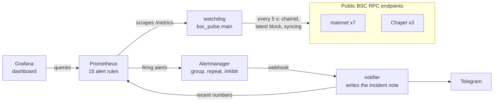
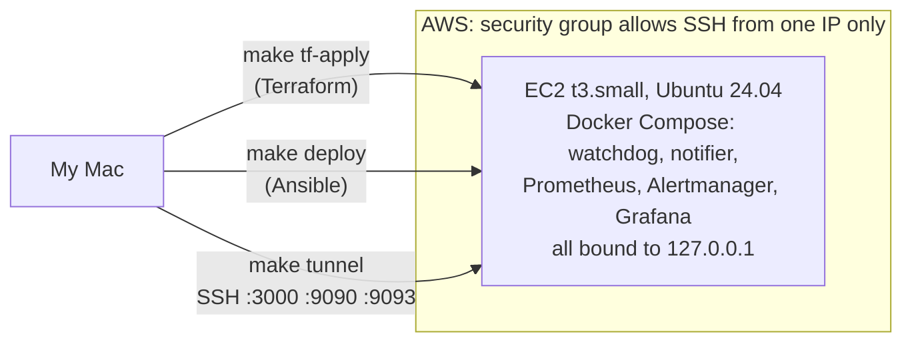

# BSC Pulse

[](https://github.com/JavierBonill4/BSC-pulse/actions/workflows/ci.yml)

**BSC Pulse watches the public BNB Smart Chain RPC endpoints, compares them with each
other, and alerts you when one falls behind, even if it still answers quickly.**

It asks ten official endpoints the same questions at the same moment, measures which
ones are behind, exports the results to Prometheus, shows them in Grafana, and sends an
incident note to Telegram when something goes wrong. Everything runs with Docker
Compose on a laptop, or on an AWS server created with Terraform and configured with
Ansible.

Built as a take-home project for a Tech Ops internship interview. It is a learning
project, not a production system. To run it, jump to [Setup](#setup).

## Contents

1. [The idea: fast is not the same as fresh](#the-idea-fast-is-not-the-same-as-fresh)
2. [How it works: one sweep through the system](#how-it-works-one-sweep-through-the-system)
3. [From numbers to a Telegram message](#from-numbers-to-a-telegram-message)
4. [Seeing it: the dashboard](#seeing-it-the-dashboard)
5. [Showing it: break an endpoint on purpose](#showing-it-break-an-endpoint-on-purpose)
6. [How it would be used](#how-it-would-be-used)
7. [Where it runs](#where-it-runs)
8. [How I know it works](#how-i-know-it-works)
9. [BNB Chain facts used, and where they come from](#bnb-chain-facts-used-and-where-they-come-from)
10. [Design decisions](#design-decisions)
11. [Known limitations](#known-limitations)
12. [What I'd do next](#what-id-do-next)
13. [What is reused and what is new](#what-is-reused-and-what-is-new)
14. [How AI was used](#how-ai-was-used)
15. [Setup](#setup)

## The idea: fast is not the same as fresh

BSC produces a block every 0.45 seconds. A normal health check asks two questions:
"are you up?" and "how fast do you answer?". That misses the failure that matters
most on a fast chain: a node that answers in 30 ms but serves a block from three
seconds ago, which is already six or seven blocks old.

You cannot see that by looking at one endpoint on its own. You can see it by asking
several endpoints the same question at the same moment and comparing their answers.

This is what the three Chapel testnet endpoints returned when I first probed them
(details in [docs/probe-notes.md](docs/probe-notes.md)):

| Endpoint | Latency | Blocks behind |
|---|---|---|
| bsc-testnet-dataseed.bnbchain.org | ~100 ms | 3 |
| bsc-testnet.bnbchain.org | ~100 ms | 3 |
| bsc-prebsc-dataseed.bnbchain.org | ~250 ms | 0 |

The two fastest endpoints were the ones behind. A latency check would have called them
the healthiest.

## How it works: one sweep through the system



Every 5 seconds the watchdog (`bsc_pulse/main.py`) runs one **sweep**. Following one
sweep is the easiest way to understand the project.

### 1. Which endpoints: `config/endpoints.yaml`

Ten URLs copied from the official BNB Chain docs: seven for mainnet (chain ID 56) and
three for the Chapel testnet (chain ID 97). An endpoint is only ever compared with
others on the same network.

### 2. Ask everyone at once: `bsc_pulse/probe.py`

A sweep has three steps. Each step runs on every endpoint in parallel (one thread per
endpoint) and finishes everywhere before the next step starts.

| Step | Method | Why |
|---|---|---|
| Identity | `eth_chainId` (and `web3_clientVersion` about once a minute) | Checks the endpoint is on the network it claims. It also opens the HTTPS connection, so the next step's latency does not include the TLS handshake: the first request took about 120 ms, later ones about 30 ms. |
| Head | `eth_getBlockByNumber("latest")` | The key measurement. One call returns the block's height, hash, parent hash and timestamp. Every endpoint is asked at the same moment, because asking one after another made later endpoints look "ahead": the chain moved on while I was asking. |
| Syncing | `eth_syncing` | Whether the node itself thinks it is catching up. |

That is three requests per endpoint every 5 seconds, about 180 per 5 minutes. The
documented limit for the public endpoints is 10K per 5 minutes.

### 3. One request, one verdict: `bsc_pulse/rpc.py`

Every call is timed, and every failure is sorted into one of six kinds. Each kind
points to a different next step when debugging:

| Kind | Usually means |
|---|---|
| `timeout` | The endpoint is overloaded, or the network path is dropping packets |
| `connection` | DNS, TCP or TLS failed: the host is down, or its DNS or certificate changed |
| `http_error` | A gateway answered 5xx because the nodes behind it are unhealthy |
| `rate_limited` | The endpoint asked us to slow down |
| `rpc_error` | The node returned a JSON-RPC error for a basic call |
| `bad_response` | The answer is not JSON-RPC at all, often a maintenance page |

One finding from the first probes shaped this: BSC sometimes rate-limits with
**HTTP 200** and JSON-RPC error **-32005** ("limit exceeded") instead of HTTP 429. The
code treats both as `rate_limited`.

### 4. What it means: `bsc_pulse/compare.py`

This is the core of the project.

- **The reference** is the highest block any usable endpoint on that network reports.
  Nobody outside knows the "true" height at a given moment, so the highest endpoint is
  the best estimate.
- **Lag** is how far each endpoint is behind the reference, in blocks and in seconds.
  The seconds come from block timestamps, not from this machine's clock, so slow round
  trips do not distort them. BSC blocks carry a `milliTimestamp` field; the standard
  `timestamp` is whole seconds, too coarse when two blocks share a second.
- **Stall timers** track how long since each endpoint's head moved, and how long since
  the network's highest head moved. An endpoint stuck while the network moves is a
  **stalled endpoint**. Nobody moving is a **stalled chain**.
- **Hash checks.** Each head carries two hashes: its own and its parent's. Two
  endpoints naming different blocks for the same height in one sweep is a
  **disagreement**. A height whose block changed since an earlier sweep is a **reorg**.
- **Head regression.** An endpoint reporting a lower block than last time usually
  means a load balancer switched to a node that is further behind.
- **Block interval** is measured from block timestamps, never assumed. That is how
  I confirmed 0.450 s on both networks.

`compare.py` never reads the clock or the network: it is given the time as an
argument. That is why its tests can describe a situation such as "endpoint b is stuck
at block 100 while endpoint a moves to 133" in a few lines.

### 5. Publish the numbers: `bsc_pulse/metrics.py`

Prometheus fetches (scrapes) `http://.../metrics` every 5 seconds. Two details matter:

- **Gauges** (values that describe "right now", like lag) are rebuilt on every scrape.
  When an endpoint dies, its lag disappears instead of freezing at its last healthy
  value.
- **Counters** (totals that only go up, like errors) are created at zero when the
  watchdog starts. Prometheus cannot see the first increase of a counter that first
  appears at 1, so the very first error would otherwise be missed.

The exporter makes no judgements. It only reports numbers; deciding what is bad is
the job of the alert rules.

<details>
<summary>All metrics</summary>

| Metric | Meaning |
|---|---|
| `bsc_endpoint_up` | 1 if the endpoint returned a valid latest block on the right chain |
| `bsc_endpoint_lag_blocks` / `bsc_endpoint_lag_seconds` | Behind the highest endpoint on the network |
| `bsc_endpoint_head_age_seconds` | This machine's clock minus the block's timestamp |
| `bsc_endpoint_head_unchanged_seconds` | Time since this endpoint's head last moved |
| `bsc_endpoint_latency_seconds` | Latency of the last head request |
| `bsc_rpc_latency_seconds` | Histogram of successful head request latency |
| `bsc_endpoint_syncing`, `bsc_endpoint_wrong_chain` | 1 when true |
| `bsc_endpoint_info` | Labels: `url`, `client_version` |
| `bsc_rpc_requests_total` | Requests by `method` and `outcome` (ok, timeout, rate_limited...) |
| `bsc_network_head_block`, `bsc_network_usable_endpoints` | Per network |
| `bsc_network_head_unchanged_seconds` | Time since the network's highest head moved |
| `bsc_network_block_interval_seconds` | Measured time per block |
| `bsc_reorg_blocks_total`, `bsc_hash_disagreements_total` | Block hash events |
| `bsc_endpoint_head_regressions_total` | Times an endpoint's head went backwards |
| `bsc_last_sweep_timestamp_seconds` | Lets an alert notice that the watchdog itself stopped |

</details>

## From numbers to a Telegram message

```
watchdog ──/metrics──► Prometheus ──rules──► Alertmanager ──webhook──► notifier ──► Telegram
                           ▲                                              │
                           └────────── asks for the recent numbers ───────┘
```

### Prometheus rules decide what is a problem

`deploy/prometheus/rules/bsc.yml` holds 15 rules. Each waits for a while before firing
(`for:`), because 2 to 3 blocks of difference is normal and a short spike should not
wake anyone up.

| Alert | Fires when | Severity |
|---|---|---|
| `BscEndpointLagging` | Head more than 5 s older than the newest head, for 2 min | warning |
| `BscEndpointStalled` | Head stuck for 30 s while the network moves | critical |
| `BscChainStalled` | Network's highest head stuck for 30 s | critical |
| `BscEndpointDown` | No valid latest block for 2 min | warning |
| `BscEndpointWrongChain` | `eth_chainId` does not match the network | critical |
| `BscEndpointSyncing` | `eth_syncing` reports progress for 5 min | warning |
| `BscEndpointErrorRate` | Over 10% of requests fail, for 5 min | warning |
| `BscEndpointRateLimited` | More than 5 rate-limit answers in 5 min | warning |
| `BscEndpointSlow` | p95 latency over 1 s for 10 min | warning |
| `BscEndpointHeadFlapping` | Head went backwards more than 3 times in 10 min | warning |
| `BscHashDisagreement` | Endpoints disagreed on a block hash more than 3 times in 10 min | warning |
| `BscReorgObserved` | A block we had seen was replaced | warning |
| `BscTooFewEndpoints` | Fewer than 2 usable endpoints, so no comparison | critical |
| `BscPulseDown`, `BscPulseSweepsStale` | The watchdog itself stopped | critical |

Thresholds are in seconds, not blocks. The block interval already changed once (from
0.75 s to 0.45 s at the Fermi hard fork), and "5 seconds behind" keeps its meaning if
it changes again. The rules have their own unit tests
(`deploy/prometheus/tests/bsc_test.yml`), and I broke two rules on purpose to check
that the tests catch it.

### Alertmanager decides when people hear about it

`deploy/alertmanager/alertmanager.yml` groups related alerts, limits repeats (a
reminder every 4 hours while still firing), and silences duplicates. If an endpoint is
down, you do not also get its error-rate and lag alerts. An end-to-end test showed
that one stuck endpoint sent both "Stalled" and "Lagging", so now "Stalled" silences
"Lagging" for the same endpoint.

### The notifier makes sure a message always goes out

`bsc_pulse/notifier.py` receives each alert from Alertmanager. Every step has a
fallback:

1. Ask Prometheus for the live numbers behind the alert (`prom.py`). If Prometheus
   does not answer, the note says the numbers are unavailable.
2. Build the incident note (`notes.py`). If that fails, send the plain alert instead.
3. Send it to Telegram (`telegram.py`). If Telegram fails, answer 502 so Alertmanager
   tries again later.

Telegram bot tokens are part of the API URL, and Python's `requests` library prints
URLs in its error messages, so `telegram.py` reports only the type of error. The token
never reaches a log.

### The incident note is a runbook written as code

`bsc_pulse/notes.py` lists the likely causes and the next checks for each alert, and
uses the live numbers to choose which causes to show:

| Situation | Cause it suggests |
|---|---|
| Lagging but fast | The node behind it imports blocks too slowly, or lost peers |
| Lagging and slow | An overloaded node, or a congested path to it |
| Head keeps going backwards | A load balancer mixing nodes at different heights |
| Stalled | Shows the client version and points at a missed hard-fork upgrade |
| Down | Depends on the dominant error kind: timeout, connection, HTTP error... |

A real note, from an end-to-end test against a fake endpoint that refused connections:

```
FIRING · warning · BscEndpointDown
127.0.0.1:18104 · mainnet

127.0.0.1:18104 (mainnet) has not returned a valid latest block for 2 minutes

Now
• status: down
• failed requests (5m): 100%
• errors (5m): connection 128
• network head: 211,421,410, 3/4 endpoints usable, block interval 450 ms

Likely causes
1. Connections fail before any HTTP answer (DNS, TCP or TLS): the host may be
   down, or its DNS or certificate changed.

Next checks
1. See where it fails (DNS, TLS, HTTP status): curl -sv http://127.0.0.1:18104
2. Check that the name still resolves: dig +short 127.0.0.1
3. Try from another machine to rule out this server's network.
```

It is rule-based on purpose: the same input always gives the same note, every sentence
can be traced to a line of code, and it cannot invent a cause.

## Seeing it: the dashboard

Grafana opens on the BSC Pulse dashboard. A drop-down at the top picks the network.

1. **Network right now**: highest block, usable endpoints, measured block interval,
   freshest head age, firing alerts, replaced blocks in 24 h.
2. **Endpoints right now**: one row per endpoint (up/down, lag, head age, p95 latency,
   failure rate, syncing), coloured at the alert thresholds. Next to it, the firing
   alerts and each endpoint's client version.
3. **Fast is not the same as fresh**: lag and latency side by side, with red dashed
   lines at the alert thresholds. This is the core idea of the project on one screen.
4. **Errors**: failed requests by kind and per endpoint.
5. **Chain**: measured block interval, time since the network head moved, and block
   hash events.

Every panel has a tooltip saying what to look for. The dashboard is generated by a
Python script (`deploy/grafana/build_dashboard.py`) and editing it in the Grafana UI
is switched off, so the dashboard in git is the one that runs.

## Showing it: break an endpoint on purpose

Waiting for a real endpoint to fail is not a demo. `make demo` adds a separate network
called `demo` with three fake endpoints (`bsc_pulse/fake_rpc.py`) that serve a
simulated chain at 0.45 s per block. They agree with each other until you break one:

```bash
make demo-break MODE=stall     # one fake endpoint freezes on its current block
make demo-heal                 # everything healthy again
```

| After | What you see |
|---|---|
| a few seconds | In Grafana (network `demo`), its lag and "time since head last moved" climb; the others stay flat |
| about 1 minute | `BscEndpointStalled` fires in Prometheus |
| about 1.5 minutes | The incident note arrives in Telegram |
| after `make demo-heal` | A short RESOLVED message |

Other modes: `lag` (20 blocks behind), `slow` (1.5 s answers), `timeout`, `error`
(HTTP 503), `ratelimit` (every other request gets 429), `wrong_chain`, `syncing`, and
`fork` (a different block at the same height, which fires `BscHashDisagreement`). The
`demo` network is never compared with mainnet or Chapel, so the real numbers stay
clean. [docs/walkthrough.md](docs/walkthrough.md) has a five-minute demo script.

## How it would be used

**By a team that depends on public endpoints**, or that runs a service on top of them.
The dashboard shows at a glance which endpoints are fresh, and an alert arrives before
users notice stale data. The lag table is a direct answer to "which endpoint should we
route traffic to right now?".

**To watch your own node.** Add your node's URL to `config/endpoints.yaml` next to the
public ones. The public endpoints then act as the reference, and your node's lag,
stalls, errors and wrong-chain answers are measured against them with no other
changes. This is the most practical next use: it turns a tool that watches other
people's infrastructure into one that watches yours.

**Around hard forks.** BSC upgrades often, and some upgrades are mandatory. A node that
was not upgraded in time stops following the chain at the fork block. Before a fork,
the client versions table shows which endpoints have upgraded. During it, a stalled
endpoint fires `BscEndpointStalled` with its version in the note.

**During an incident.** The Telegram note is the first page of the runbook: what the
numbers say now, the likely causes for this situation, and commands ready to paste.
During planned maintenance, a silence in Alertmanager (http://127.0.0.1:9093) keeps
the noise down.

**For practice and demos.** The fake endpoints let anyone rehearse the full alert path
on a laptop, with no real outage needed.

A normal day looks like this: the dashboard stays open on the "Endpoints right now"
table; most days nothing fires; when something does, the note says where to start.

## Where it runs

The same `docker-compose.yml` runs five containers on a laptop or on a server: the
watchdog, the notifier, Prometheus, Alertmanager and Grafana. Every port is bound to
127.0.0.1, and a test enforces that.



- **Terraform** (`infra/terraform/`) creates one Ubuntu 24.04 server. SSH is the only
  open port, and only from one IP: `allowed_ssh_cidrs` has no default and rejects
  `0.0.0.0/0`.
- **Ansible** (`infra/ansible/`) hardens the server (SSH keys only, firewall, fail2ban),
  installs Docker, copies the app, writes the secrets from `.env` into a file only root
  can read, starts the stack, and then checks that it really works: real blocks in the
  metrics, and a healthy Grafana.
- **The dashboards are reached through an SSH tunnel** (`make tunnel`), never exposed
  to the internet.

## How I know it works

| What | How | Where it runs |
|---|---|---|
| Python logic (163 tests) | pytest with fake HTTP sessions, no network | `make check`, CI on Python 3.9 and 3.12 |
| Alert rules | promtool replays made-up metric history and checks when each alert fires | `make rules-test`, CI |
| Prometheus and Alertmanager configs | `promtool check config`, `amtool check-config` | CI |
| Dashboard | JSON matches its builder; every query uses an exported metric; panels do not overlap | pytest, CI |
| Compose security | Every published port is on 127.0.0.1; no `:latest` images; no default Grafana password | pytest |
| Docs | Every `make` target, file and link mentioned in the docs exists | pytest |
| Terraform | `fmt -check` and `validate` | CI |
| Ansible | `--syntax-check` and `ansible-lint` (production profile) | CI |
| Whole pipeline | Fake endpoints, the real watchdog, real Prometheus and Alertmanager binaries, notifier in dry-run mode; endpoints broken on purpose | by hand, during the build |

The end-to-end runs found three real problems the unit tests had missed: one stuck
endpoint produced two messages, a 50-second incident was reported as "lasted 0m", and
the `dig` suggestion included a port number.

## BNB Chain facts used, and where they come from

I am new to BNB Chain, so every chain-specific number was checked against an official
source before it went into the code or this README.

| Fact | Source |
|---|---|
| Mainnet chain ID 56, Chapel testnet 97; the ten public endpoints; rate limit "10K/5min"; `eth_getLogs` disabled on the public mainnet endpoints | [BNB Chain docs: JSON-RPC endpoints](https://docs.bnbchain.org/bnb-smart-chain/developers/json_rpc/json-rpc-endpoint/) |
| Block interval reduced from 0.75 s to 0.45 s by the Fermi hard fork (mainnet planned for 2026-01-14) | [bsc v1.6.4 release notes](https://github.com/bnb-chain/bsc/releases) |
| Pasteur hard fork (BEP-673) on mainnet at 2026-08-25 02:30 UTC; v1.7.7 was a mandatory upgrade | [bsc v1.7.7 release notes](https://github.com/bnb-chain/bsc/releases) |
| v1.8.1 schedules the Jenner hard fork on Chapel only (2026-10-29); mainnet was not scheduled at the time | [bsc v1.8.1 release notes](https://github.com/bnb-chain/bsc/releases) |
| Block interval of 0.450 s on both networks; a `milliTimestamp` field in every block; rate limits returned as HTTP 200 with error `-32005`; `finalized` about 2 blocks behind `latest` | My own probes: [docs/probe-notes.md](docs/probe-notes.md) |

BSC is a fork of Geth (go-ethereum), so the standard Ethereum JSON-RPC methods work.
What the code assumes about BSC is kept small on purpose: the block interval is
measured rather than configured, and alert thresholds are in seconds, so the tool
keeps working through the next change to block times. Mainnet and Chapel can run
different fork rules at the same time, which is one more reason networks are never
compared with each other.

## Design decisions

### Measuring

1. **Compare endpoints with each other, not with a fixed expectation.** Nobody outside
   knows the "right" height at any moment. The highest height on the same network is
   the best reference available.
2. **Look at real responses before writing logic.** Probing by hand first is how I
   found the millisecond timestamp field and the rate-limit error hidden in an HTTP 200.
3. **Ask every endpoint at the same moment.** Asking one after another made later
   endpoints look ahead, because the chain moved on in between.
4. **Use `eth_getBlockByNumber("latest")`, not `eth_blockNumber`.** One call returns
   height, hash and timestamp: the hash is needed for reorg detection, the timestamp
   for head age.
5. **Use `milliTimestamp` for head age.** The standard `timestamp` is in whole
   seconds, too coarse when several blocks share one second.
6. **Sort failures into six kinds.** Each kind points to a different next step.
7. **A failed request is a result, not a crash.** One dead endpoint must not stop the
   others from being probed.
8. **Keep "what was said" separate from "what it means".** `probe.py` collects
   answers; `compare.py` interprets them and is given the time as an argument, so every
   comparison can be tested with made-up sweeps.
9. **Tests never touch the network.** CI cannot fail because a public endpoint had a
   bad minute.

### Exporting and alerting

10. **The exporter decides nothing.** What counts as bad, and for how long, belongs in
    the alert rules, which can change without touching the code.
11. **Rebuild the gauges on every scrape**, so a dead endpoint's lag disappears
    instead of freezing at a healthy-looking value.
12. **Create every counter at zero at startup**, so the first error is visible.
13. **A latency histogram, not only a last value.** A single value hides spikes; the
    histogram gives percentiles.
14. **Alert thresholds in seconds, not blocks**, because block times change with hard
    forks.
15. **Every alert waits before firing.** Endpoints are 2 to 3 blocks apart on a normal
    day.
16. **Test the alert rules, not only the Python.**
17. **Incident notes are rule-based, not written by an LLM.** Same input, same note;
    every sentence traceable; no invented causes. The live numbers still choose which
    causes appear.
18. **An alert always goes out**, whatever part of the notifier fails.
19. **The bot token never reaches a log.**

### Running it

20. **One Compose file on the laptop and the server**, so what I test locally is what
    runs.
21. **Fake endpoints as a separate network**, so demos never touch the real numbers.
22. **The dashboard is code**, reviewable in a pull request.
23. **No default passwords.** Compose refuses to start Grafana until `.env` sets one.
24. **SSH from the whole internet is refused by Terraform.**
25. **A deploy checks that it worked**, instead of stopping once containers start.

### Alternatives I rejected

- **Extending my Bash health check.** Fine for one endpoint; comparing ten in parallel
  and unit-testing the logic is awkward in Bash.
- **A Web3 library (web3.py).** The tool needs four JSON-RPC methods. Calling them
  directly keeps dependencies short and the raw responses visible.
- **asyncio.** Threads do the same job here (one per endpoint) and are simpler to read.
- **Writing textfile metrics for node-exporter**, as my Bash script did. That suits a
  cron job; a long-running service can serve `/metrics` itself.
- **Alerting from the Python code, or with Grafana's alerting.** Prometheus and
  Alertmanager already handle "for how long", grouping, repeats and silences, and
  their rules can be unit-tested.
- **Alertmanager's built-in Telegram receiver.** It sends the alert text but cannot
  look up live numbers or choose causes.
- **An LLM writing the notes.** See decision 17; it is under "What I'd do next".
- **An extra request per sweep to compare a fixed recent block on every endpoint.** It
  would catch more disagreements but adds load.
- **Host networking in Compose**, as in eth-node-iac. It behaves differently on Docker
  Desktop for Mac, and service names are clearer.
- **Building the image in CI and pushing it to a registry.** Right for a team; for one
  server it means running a registry and managing its credentials.
- **Kubernetes or ECS.** Five small containers on one host do not need an orchestrator.
- **Grafana open to the internet behind a password.** An SSH tunnel keeps the attack
  surface at one port.

## Known limitations

**Measurement**

- Everything is measured from one place. A slow network path from this machine looks
  the same as a slow endpoint, and head age depends on this machine's clock.
- A public endpoint URL is probably a load balancer in front of several nodes, so two
  requests to it may reach different nodes.
- All three Chapel endpoints are on `bnbchain.org` and may share failures.
- Reorg and disagreement detection only sees the heights endpoints happen to report
  (and their parents). It samples the chain rather than checking every block.
- `web3_clientVersion` is for information only; at least one endpoint reports a
  version that does not match its behaviour.

**Alerting**

- Thresholds are educated guesses from a short look at normal behaviour, not tuned
  against a long baseline. The hash-disagreement threshold in particular is a guess.
- The incident notes list causes I wrote myself: a starting point for investigation,
  not a diagnosis.
- `BscHashDisagreement` and `BscReorgObserved` use a 10-minute window, so they stay
  firing for up to 10 minutes after the cause is gone.
- One Telegram chat receives everything; there is no routing by severity.

**Operations**

- One server, no redundancy. If it dies, so does the monitoring, and nobody is told.
- State lives in memory: after a restart, stall timers and hash history start empty.
- Terraform state is a local file, not a shared backend.
- Images are built on the server and dependencies are version ranges, not locked, so
  two deploys can produce slightly different images.
- The dashboard's queries are tested against a real Prometheus, but the dashboard
  itself is not rendered in CI.

## What I'd do next

In rough order of value:

1. **Run it for a week, then set the thresholds from the data**: each endpoint's normal
   lag and latency percentiles instead of round numbers.
2. **Point it at my own node.** Run a Chapel node and add it to the config, so the
   public endpoints become the reference for it, and add the node's own metrics. That
   is closer to the day-to-day work of running infrastructure than watching public
   endpoints.
3. **Compare the `finalized` block across endpoints.** With fast finality, endpoints
   that disagree there point to something far more serious than tip lag.
4. **Watch the watchdog from outside**: an always-firing "heartbeat" alert sent to an
   external dead-man's-switch service, so silence itself raises an alarm.
5. **A second vantage point in another region**, to tell a slow network path from a
   slow endpoint.
6. **Subscribe to new heads over WebSocket** (`eth_subscribe("newHeads")`) to see when
   each endpoint first learns of a block, which measures propagation delay without
   polling.
7. **An optional LLM summary in the notes**, behind the same interface, allowed to use
   only the numbers in the context, with the rule-based note as the fallback.
8. **Route by severity and silence planned work**, for example a scheduled hard fork.
9. **Build the image in CI, push it to a registry, and deploy by digest**; keep
   Terraform state in S3 with locking.
10. **The optional on-chain part of the original plan**: a small contract on Chapel
    where the watchdog records heartbeats, and a static status page that reads it.

## What is reused and what is new

This builds on my earlier learning project, `eth-node-iac` (Terraform, Ansible and
Prometheus/Grafana watching one Ethereum Sepolia endpoint with a Bash health check).

| | From eth-node-iac | New here |
|---|---|---|
| Signals | Up, latency, block number, syncing | Lag against other endpoints, head age, error kinds, stalls, reorgs |
| Health check | One endpoint, Bash + cron | Many endpoints in parallel, Python, unit tested |
| Metrics | Textfile written for node-exporter | The service serves `/metrics` itself |
| Alerting | Seven Prometheus rules (host and one RPC endpoint) | 15 rules with unit tests, Alertmanager, Telegram incident notes |
| Compose | Host networking, `:latest` images | Private network, ports on 127.0.0.1, pinned versions |
| Grafana | Default password in a variables file | Password required from `.env`; dashboard generated from a script |
| Terraform | EC2, security group, key pair, Ubuntu AMI via SSM, IMDSv2, encrypted disk, generated inventory | SSH CIDR required and validated; P2P ports removed |
| Ansible | `hardening` and `docker` roles, nearly unchanged | `bsc_pulse` role: copy the app, write secrets from `.env`, compose up, smoke test |
| Access | Everything on 127.0.0.1, SSH tunnel, SSH limited to my IP | Same, plus a test that no Compose port is public |
| Conventions | Makefile targets, `.gitignore` rules | Lint, tests and CI |

## How AI was used

The brief for this project was to use AI to build and launch something quickly. I
built it with Claude (Anthropic), working in Claude's Cowork mode with access to this
repository on my Mac.

**What I did:** chose the project and its scope; decided the main trade-offs (Python,
rule-based notes instead of an LLM, SSH tunnel instead of public dashboards); asked for
the work in small steps, each with an explanation of what changed and why; reviewed
each step; and made every commit myself.

**What Claude did:** checked my starting facts about BNB Chain against the official
docs and the `bnb-chain/bsc` release notes (several numbers I had were press reports);
probed the real endpoints before any logic was written; proposed the structure; wrote
the first version of the code, tests, configuration and this README; and ran
end-to-end tests with fake endpoints and real Prometheus and Alertmanager binaries.

**How the output was checked:** 163 unit tests, unit tests for the alert rules (with
two rules broken on purpose to prove the tests catch it), lint and CI, and end-to-end
runs that broke endpoints on purpose. Those runs caught real mistakes in the AI-written
code: duplicate alerts for one problem, a wrong duration in resolved messages, and a
command suggestion with a port number in it. A compatibility check also found that the
tests failed on Python 3.9, the default `python3` on macOS.

---

# Setup

Three ways to run it, from lightest to fullest. Each builds on the one before.

| Option | What you get | Needs | Time |
|---|---|---|---|
| [A. The watchdog only](#a-the-watchdog-only) | The comparison table and raw metrics in a terminal | Python, make | 5 min |
| [B. The full stack on your computer](#b-the-full-stack-on-your-computer) | Dashboard, alerts, Telegram notes, the demo | + Docker | 15 min |
| [C. Deploy to AWS](#c-deploy-to-aws) | The full stack on a hardened cloud server | + AWS, Terraform, Ansible | 30 min |

## Prerequisites

The commands below are for macOS with [Homebrew](https://brew.sh). On Linux, install
the same tools with your package manager.

| Tool | Needed for | Install on macOS | Check |
|---|---|---|---|
| git, make | everything | `xcode-select --install` | `make --version` |
| Python 3.9 or newer | A, B, C | included with the command above, or `brew install python@3.12` | `python3 --version` |
| Docker Desktop | B (and `make rules-test`) | [docker.com/products/docker-desktop](https://www.docker.com/products/docker-desktop/), then start it | `docker compose version` |
| Telegram account | B, C (optional) | the Telegram app | |
| AWS account and CLI | C | `brew install awscli`, then `aws configure` | `aws sts get-caller-identity` |
| Terraform 1.5 or newer | C | `brew tap hashicorp/tap && brew install hashicorp/tap/terraform` | `terraform version` |
| Ansible | C | `brew install ansible` | `ansible --version` |
| An SSH key | C | `ssh-keygen -t ed25519` (if you do not have one) | `ls ~/.ssh/id_ed25519.pub` |

Get the code:

```bash
git clone https://github.com/JavierBonill4/BSC-pulse.git
cd BSC-pulse
make help            # lists every command in this README
```

## A. The watchdog only

```bash
make setup           # creates .venv and installs the dependencies
make check           # lint and all tests (no network needed)
make probe           # one live sweep of every endpoint, printed as a table
```

`make probe` prints one table per network: block, blocks behind the highest endpoint,
head age, latency, syncing and client version. It exits with 1 if any endpoint is
unusable.

Example output, using the real values from the first probe of the endpoints on
2026-11-15 ([docs/probe-notes.md](docs/probe-notes.md)). On Chapel, the two faster
endpoints are the ones behind:

```
mainnet (chain 56): highest block 133785879, 7/7 endpoints usable
  ENDPOINT                               BLOCK  BEHIND  HEAD AGE  LATENCY  SYNCING  CLIENT
  bsc-dataseed.bnbchain.org          133785879       0     0.42s     27ms  no       Geth/v1.8.2/linux-amd64/go1.26.10
  bsc-dataseed-public.bnbchain.org   133785879       0     0.70s    308ms  no       Geth/v1.1.16-cb131fab/linux-amd64/go1.17.5
  bsc-dataseed.nariox.org            133785879       0     0.42s     27ms  no       Geth/v1.8.2-4e1c8247-20261104/linux-amd64/go
  bsc-dataseed.defibit.io            133785879       0     0.42s     28ms  no       Geth/v1.8.2-4e1c8247-20261104/linux-amd64/go
  bsc-dataseed.ninicoin.io           133785879       0     0.42s     27ms  no       Geth/v1.8.2/linux-amd64/go1.26.10
  bsc.nodereal.io                    133785879       0     0.42s     28ms  no       Geth/v1.8.2-4e1c8247-20261104/linux-amd64/go
  rpc-bnb.blockmachine.io            133785879       0     0.45s     53ms  no       blockmachine-gateway/v0.1.0

chapel (chain 97): highest block 142923292, 3/3 endpoints usable
  ENDPOINT                                BLOCK  BEHIND  HEAD AGE  LATENCY  SYNCING  CLIENT
  bsc-testnet-dataseed.bnbchain.org   142923290       2     1.65s     98ms  no       Geth/v1.8.1-56d84e62-20261019/linux-amd64/go
  bsc-testnet.bnbchain.org            142923290       2     1.64s     97ms  no       Geth/v1.8.1-56d84e62-20261019/linux-amd64/go
  bsc-prebsc-dataseed.bnbchain.org    142923292       0     0.89s    244ms  no       Geth/v1.8.1/linux-amd64/go1.26.10
```

To run the watchdog continuously and see its raw metrics:

```bash
make run             # sweeps every 5 s; leave it running (Ctrl+C to stop)
make metrics         # in a second terminal: lag, head age and network numbers
```

The full list of metrics is at http://127.0.0.1:9105/metrics.

## B. The full stack on your computer

### 1. Create your `.env`

```bash
cp .env.example .env
```

Open `.env` and set `GRAFANA_ADMIN_PASSWORD` (at least 8 characters). Compose refuses
to start without it. `.env` is git-ignored; never commit it.

### 2. Optional: connect Telegram

Without this, alerts still work, but the notes only appear in the notifier's log.

1. In Telegram, message **@BotFather**, send `/newbot`, and follow the prompts. Copy
   the token it gives you.
2. Send any message to your new bot (it cannot write to you first).
3. Open `https://api.telegram.org/bot<TOKEN>/getUpdates` in a browser, with your
   token in place of `<TOKEN>`. Copy the number after `"chat":{"id":`.
4. Put both in `.env` as `TELEGRAM_BOT_TOKEN` and `TELEGRAM_CHAT_ID`.
5. Send a test note (needs `make setup` from option A):

   ```bash
   set -a; source .env; set +a
   make telegram-test
   ```

### 3. Start the stack

```bash
make up              # builds the image, starts five containers
```

| Open | What | Login |
|---|---|---|
| http://127.0.0.1:3000 | Grafana: the BSC Pulse dashboard | `admin` / your `GRAFANA_ADMIN_PASSWORD` |
| http://127.0.0.1:9090 | Prometheus: queries, and alert states under Alerts | none |
| http://127.0.0.1:9093 | Alertmanager: active alerts, silences | none |
| http://127.0.0.1:9105/metrics | The watchdog's raw metrics | none |

### 4. Check it works

- Grafana: after about a minute, "Usable endpoints" shows the number of endpoints
  answering (normally 7 for mainnet and 3 for Chapel), and the block interval reads
  about 0.45 s.
- http://127.0.0.1:9090/targets: the `bsc-pulse` target is UP.
- `make alert-test` posts a fake alert straight to the notifier; a note should appear
  in Telegram, or in `docker compose logs notifier` if Telegram is not set up.
- `make rules-test` runs the alert-rule unit tests in Docker.

### 5. Try the demo

```bash
make demo                      # the same stack plus three fake endpoints
make demo-break MODE=stall     # break one; pick network "demo" in Grafana
make demo-status               # what each fake endpoint is doing
make demo-heal                 # fix it; a RESOLVED message follows
```

See [Showing it](#showing-it-break-an-endpoint-on-purpose) for what to expect and when.

### 6. Stop

```bash
make down                              # stop; Prometheus and Grafana data are kept
docker compose --profile demo down     # after make demo, also stops the fake endpoints
docker compose down -v                 # stop and delete all stored data
```

## C. Deploy to AWS

This creates a server that costs money while it runs. Remember the last step.

### 1. Configure Terraform

```bash
cp infra/terraform/terraform.tfvars.example infra/terraform/terraform.tfvars
curl https://checkip.amazonaws.com            # your public IP
```

Edit `infra/terraform/terraform.tfvars` and set
`allowed_ssh_cidrs = ["<your IP>/32"]`. That file is git-ignored. Make sure `.env`
exists with `GRAFANA_ADMIN_PASSWORD` set (and Telegram, if you want it): the deploy
copies those secrets to the server.

### 2. Create the server

```bash
make ansible-deps    # once: the Ansible collections the playbook uses
make tf-init         # once: download the Terraform providers
make tf-plan         # read what will be created: a server, a security group and its rules, a key pair
make tf-apply        # type "yes" to create it; this also writes the Ansible inventory
```

### 3. Deploy

```bash
make ping            # retry for about a minute after apply, until it answers "pong"
make deploy          # harden, install Docker, start the stack, check it works
```

The first deploy takes a few minutes, mostly the Docker build. It finishes only when
the watchdog reports real blocks and Grafana is healthy, and it prints how many
endpoints are usable on each network.

### 4. Open the dashboards

```bash
make tunnel          # leave this running
```

Then open http://127.0.0.1:3000 on your computer, exactly as in option B. Other
commands: `make ssh` opens a shell on the server (the stack is in `/opt/bsc-pulse`),
and `make deploy-demo` adds the fake endpoints so the demo commands from option B work
through the tunnel.

### 5. Destroy the server when you are done

```bash
make tf-destroy      # type "yes"; deletes everything tf-apply created
```

A t3.small costs a few US cents per hour; check your own pricing and credits. Destroy
it when you are not using it, and redeploy later with `make tf-apply` and `make deploy`.

## Configuration

### Settings

| Variable | Used by | Default | What it does |
|---|---|---|---|
| `GRAFANA_ADMIN_PASSWORD` | Grafana | none, required | Admin password |
| `TELEGRAM_BOT_TOKEN`, `TELEGRAM_CHAT_ID` | notifier | empty (dry run) | Where incident notes go |
| `BSC_PULSE_INTERVAL` | watchdog | `5` | Seconds between sweeps |
| `BSC_PULSE_TIMEOUT` | watchdog | `3` | Seconds per request; must be shorter than the interval |
| `BSC_PULSE_CONFIG` | watchdog | `config/endpoints.yaml` | Endpoint file(s), comma-separated |
| `BSC_PULSE_LISTEN` | watchdog | `127.0.0.1:9105` (`0.0.0.0:9105` in Docker) | Where `/metrics` is served |
| `PROMETHEUS_URL` | notifier | `http://127.0.0.1:9090` (`http://prometheus:9090` in Docker) | Where to fetch the numbers for notes |
| `NOTIFIER_LISTEN` | notifier | `127.0.0.1:9106` (`0.0.0.0:9106` in Docker) | Where Alertmanager sends alerts |

Docker Compose reads `.env` automatically. For the Python commands (`make run`,
`make telegram-test`), load it first with `set -a; source .env; set +a`.

### Watching another endpoint

Add its URL under the right network in `config/endpoints.yaml`:

```yaml
networks:
  mainnet:
    chain_id: 56
    endpoints:
      - https://bsc-dataseed.bnbchain.org
      - https://my-node.example.com      # your own node, compared with the public ones
```

Then run `make up` again (the config is built into the image), or `make deploy` on the
server. A typo in this file stops the watchdog at startup with a clear message.

### Changing an alert

Edit `deploy/prometheus/rules/bsc.yml`, update the matching test in
`deploy/prometheus/tests/bsc_test.yml`, and run `make rules-test`. Prometheus picks up
the change after `docker compose restart prometheus`, or a `make deploy` on the server.

### Changing the dashboard

Edit `deploy/grafana/build_dashboard.py`, run `make dashboard`, then
`docker compose restart grafana`.

## Troubleshooting

| Symptom | Likely cause and fix |
|---|---|
| `make up` says `required variable GRAFANA_ADMIN_PASSWORD is missing a value` | No `.env`, or the password is empty. See [B.1](#1-create-your-env). |
| `Cannot connect to the Docker daemon` | Docker Desktop is not running. Start it and try again. |
| `port is already allocated` | Something else on your computer uses 3000, 9090, 9093, 9105 or 9106. Stop it, or change the left-hand port in `docker-compose.yml`. |
| `make setup` or `make check` fails on Python | You need Python 3.9 or newer: `python3 --version`. |
| Grafana panels are empty | Wait a minute after start-up; check the network drop-down at the top; check that `bsc-pulse` is UP at http://127.0.0.1:9090/targets. |
| `make telegram-test` says `chat not found` | Send your bot a message first, then read the chat ID again from `getUpdates`. |
| `make telegram-test` says `Unauthorized` | The token is wrong. Copy it again from @BotFather. |
| An alert fired but no Telegram message | `docker compose logs notifier`. "dry run" means the token or chat ID is missing: fix `.env`, then run `make up` again so the container picks it up. |
| `make tf-apply` complains about `allowed_ssh_cidrs` | It must be your IP as a /32 in `terraform.tfvars`; `0.0.0.0/0` is refused on purpose. |
| `make ping` times out | The server is still booting (wait a minute), or your IP changed: update `allowed_ssh_cidrs` and run `make tf-apply` again. |
| `make deploy` fails at "Check that the secrets were loaded" | `GRAFANA_ADMIN_PASSWORD` is missing from `.env` or shorter than 8 characters. |
| `make deploy` fails at "Wait until the watchdog reports a network head" | `make ssh`, then `cd /opt/bsc-pulse && sudo docker compose logs bsc-pulse` to see why no endpoint answered. |

## Command reference

`make help` prints all of these.

| Command | What it does |
|---|---|
| `make setup` / `make check` | Install dependencies / run lint and all tests |
| `make probe` | One live sweep, printed as a table |
| `make run` / `make metrics` | Run the watchdog in the terminal / show its key metrics |
| `make up` / `make down` / `make logs` | Start, stop, and follow the logs of the Docker stack |
| `make demo` / `make demo-break MODE=...` / `make demo-heal` / `make demo-status` | The demo with fake endpoints |
| `make telegram-test` / `make alert-test` | Send a sample note / post a fake alert to the notifier |
| `make notify` / `make fake-rpc` | Run the notifier or the fake endpoints without Docker |
| `make rules-test` / `make dashboard` | Test the alert rules / rebuild the dashboard JSON |
| `make tf-init` / `make tf-plan` / `make tf-apply` / `make tf-destroy` | Terraform: set up, preview, create, delete the server |
| `make ansible-deps` / `make ping` / `make deploy` / `make deploy-demo` | Ansible: set up, test the connection, deploy, deploy with the demo |
| `make tunnel` / `make ssh` | Reach the server's dashboards / open a shell on it |

## Repository layout

| Path | What |
|---|---|
| `bsc_pulse/` | The Python package: watchdog, notifier, fake endpoints |
| `config/endpoints.yaml` | The endpoints watched, copied from the official docs |
| `config/endpoints.demo.yaml` | The fake `demo` network, used only by `make demo` |
| `deploy/prometheus/` | Prometheus config, alert rules and their unit tests |
| `deploy/alertmanager/` | Grouping, repeats and inhibition |
| `deploy/grafana/` | Dashboard builder, generated JSON, provisioning |
| `infra/terraform/` | The AWS server |
| `infra/ansible/` | Server hardening, Docker, and deploying the stack |
| `tests/` | Unit tests; none of them touch the network |
| `docs/probe-notes.md` | What the real endpoints returned before any logic was written |
| `docs/walkthrough.md` | A guided tour of the code and a five-minute demo script |
