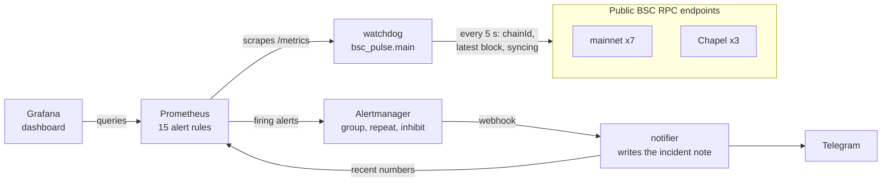
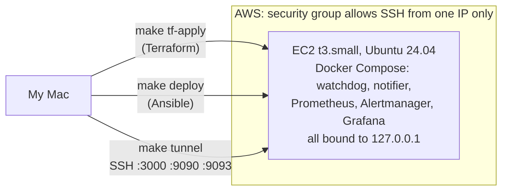

# BSC Pulse

[](https://github.com/JavierBonill4/BSC-pulse/actions/workflows/ci.yml)

A watchdog for public BNB Smart Chain RPC endpoints. It asks several endpoints the
same questions at the same moment and compares the answers, so it notices when an
endpoint falls behind the others even though it still answers quickly. It exports
Prometheus metrics, ships a Grafana dashboard, and sends an incident note to
Telegram when something goes wrong.

Built as a take-home project for a Tech Ops internship interview. It is a learning
project, not a production system. A guided tour of the code is in
[docs/walkthrough.md](docs/walkthrough.md).

<!-- TODO(Javier): add screenshots: Grafana on mainnet, Grafana with a stalled demo
endpoint, and a real Telegram incident note. -->

## The idea: fast is not the same as fresh

A health check that asks "did you answer, and how fast?" misses the failure that
matters most on a fast chain: a node that answers in 30 ms with old data. BSC
produces a block every 0.45 s, so a node two seconds behind is already four or five
blocks stale. From outside, the only way to see it is to compare it with other
endpoints on the same network.

This is what the three Chapel testnet endpoints returned when asked at the same
moment while I was exploring them (from [docs/probe-notes.md](docs/probe-notes.md)):

| Endpoint | Latency | Blocks behind |
|---|---|---|
| bsc-testnet-dataseed.bnbchain.org | ~100 ms | 3 |
| bsc-testnet.bnbchain.org | ~100 ms | 3 |
| bsc-prebsc-dataseed.bnbchain.org | ~250 ms | 0 |

The two fastest endpoints were the ones behind.

## Architecture



| Component | Job |
|---|---|
| `bsc_pulse/rpc.py` | One JSON-RPC call: send it, time it, sort any failure into a named kind |
| `bsc_pulse/probe.py` | One sweep: every endpoint asked at the same moment |
| `bsc_pulse/compare.py` | Compares endpoints on the same network and remembers what changed between sweeps |
| `bsc_pulse/metrics.py` | Turns each comparison into Prometheus metrics |
| `bsc_pulse/main.py` | The service loop: sweep, compare, export, sleep |
| `deploy/prometheus/rules/bsc.yml` | Decides what counts as a problem, and for how long it must last |
| `deploy/alertmanager/alertmanager.yml` | Groups alerts, limits repeats, silences alerts another alert already explains |
| `bsc_pulse/notifier.py` | Receives each alert and makes sure a message goes out, whatever fails |
| `bsc_pulse/notes.py` | The runbook as code: what we see, likely causes, next checks |
| `deploy/grafana/build_dashboard.py` | The dashboard, defined as code |
| `bsc_pulse/fake_rpc.py` | Fake endpoints you can break on purpose, for demos and tests |

One sweep has three steps. Each runs on all endpoints at once and finishes
everywhere before the next starts:

1. **Identity**: `eth_chainId` every sweep, `web3_clientVersion` about once a
   minute. This also opens the HTTPS connection, so step 2's latency does not
   include connection setup.
2. **Head**: `eth_getBlockByNumber("latest")` on every endpoint at the same moment.
3. **Syncing**: `eth_syncing`.

That is three requests per endpoint every 5 seconds, about 180 per 5 minutes. The
documented limit for the public endpoints is 10K per 5 minutes.

## What it measures

- **Lag**: how far each endpoint is behind the highest endpoint on its network, in
  blocks and in seconds (from block timestamps, so round trips do not distort it).
- **Stalled endpoint**: its head has not moved for a while, but the network's has.
- **Stalled chain**: the network's highest head has not moved for a while.
- **Hash disagreement**: two endpoints name different blocks for the same height in
  the same sweep. Each head gives two hashes: its own, and its parent's.
- **Reorg**: a height recorded earlier now has a different block.
- **Head regression**: an endpoint reports a lower head than last time, which
  usually means a load balancer switched to a node that is further behind.
- **Errors by kind**: timeout, connection, rate limited, HTTP error, RPC error, bad
  response. Each kind points to a different next step.
- **Block interval**: measured from block timestamps, not assumed.

<details>
<summary>All metrics</summary>

| Metric | Meaning |
|---|---|
| `bsc_endpoint_up` | 1 if the endpoint returned a valid latest block on the right chain |
| `bsc_endpoint_lag_blocks` / `bsc_endpoint_lag_seconds` | Behind the highest endpoint on the network |
| `bsc_endpoint_head_age_seconds` | This machine's clock minus the block's timestamp |
| `bsc_endpoint_head_unchanged_seconds` | Time since this endpoint's head last moved |
| `bsc_endpoint_latency_seconds` | Latency of the last head request |
| `bsc_rpc_latency_seconds` | Histogram of successful head request latency |
| `bsc_endpoint_syncing`, `bsc_endpoint_wrong_chain` | 1 when true |
| `bsc_endpoint_info` | Labels: `url`, `client_version` |
| `bsc_rpc_requests_total` | Requests by `method` and `outcome` (ok, timeout, rate_limited...) |
| `bsc_network_head_block`, `bsc_network_usable_endpoints` | Per network |
| `bsc_network_head_unchanged_seconds` | Time since the network's highest head moved |
| `bsc_network_block_interval_seconds` | Measured time per block |
| `bsc_reorg_blocks_total`, `bsc_hash_disagreements_total` | Block hash events |
| `bsc_endpoint_head_regressions_total` | Times an endpoint's head went backwards |
| `bsc_last_sweep_timestamp_seconds` | Lets an alert notice that the watchdog itself stopped |

</details>

## Alerts and incident notes

| Alert | Fires when | Severity |
|---|---|---|
| `BscEndpointLagging` | Head more than 5 s older than the newest head, for 2 min | warning |
| `BscEndpointStalled` | Head stuck for 30 s while the network moves | critical |
| `BscChainStalled` | Network's highest head stuck for 30 s | critical |
| `BscEndpointDown` | No valid latest block for 2 min | warning |
| `BscEndpointWrongChain` | `eth_chainId` does not match the network | critical |
| `BscEndpointSyncing` | `eth_syncing` reports progress for 5 min | warning |
| `BscEndpointErrorRate` | Over 10% of requests fail, for 5 min | warning |
| `BscEndpointRateLimited` | More than 5 rate-limit answers in 5 min | warning |
| `BscEndpointSlow` | p95 latency over 1 s for 10 min | warning |
| `BscEndpointHeadFlapping` | Head went backwards more than 3 times in 10 min | warning |
| `BscHashDisagreement` | Endpoints disagreed on a block hash more than 3 times in 10 min | warning |
| `BscReorgObserved` | A block we had seen was replaced | warning |
| `BscTooFewEndpoints` | Fewer than 2 usable endpoints, so no comparison | critical |
| `BscPulseDown`, `BscPulseSweepsStale` | The watchdog itself stopped | critical |

Alertmanager silences duplicates: an endpoint that is down does not also send
error-rate, latency and lag alerts, and a stalled endpoint does not also send a lag
alert.

Each firing alert becomes a note like this one, produced in an end-to-end test
against a fake endpoint that refused connections:

```
FIRING · warning · BscEndpointDown
127.0.0.1:18104 · mainnet

127.0.0.1:18104 (mainnet) has not returned a valid latest block for 2 minutes

Now
• status: down
• failed requests (5m): 100%
• errors (5m): connection 128
• network head: 211,421,410, 3/4 endpoints usable, block interval 450 ms

Likely causes
1. Connections fail before any HTTP answer (DNS, TCP or TLS): the host may be
   down, or its DNS or certificate changed.

Next checks
1. See where it fails (DNS, TLS, HTTP status): curl -sv http://127.0.0.1:18104
2. Check that the name still resolves: dig +short 127.0.0.1
3. Try from another machine to rule out this server's network.
```

The causes depend on the live numbers. A lagging endpoint that answers in 40 ms
gets "it serves old data: the node imports blocks too slowly". One that is also slow
gets "overloaded node or congested path". One whose head keeps going backwards gets
"load balancer mixing nodes". A stalled endpoint's note shows its client version and
points at missed hard-fork upgrades.

## Dashboard

Top to bottom:

1. **Network right now**: highest block, usable endpoints, measured block interval,
   freshest head age, firing alerts, replaced blocks in 24 h.
2. **Endpoints right now**: one row per endpoint (up/down, lag, head age, p95
   latency, failure rate, syncing), coloured at the alert thresholds. Plus the
   firing alerts and each endpoint's client version.
3. **Fast is not the same as fresh**: lag and latency side by side. Red dashed lines
   are the alert thresholds.
4. **Errors**: failed requests by kind and per endpoint.
5. **Chain**: measured block interval, time since the network head moved, and block
   hash events.

Every panel has a tooltip saying what to look for. The dashboard is generated by
`deploy/grafana/build_dashboard.py` (`make dashboard`); a test checks that the JSON
is up to date and that every query uses a metric the watchdog really exports.

## Run it locally

Needs Python 3.9 or newer and `make`. Docker (Docker Desktop on a Mac) is only
needed for the full stack.

```bash
make setup        # creates .venv and installs dependencies
make check        # lint + tests, the same checks CI runs
make probe        # one live sweep of every endpoint, printed as a table
make run          # the watchdog alone: metrics on http://127.0.0.1:9105/metrics
```

`make probe` prints one table per network: block, blocks behind the highest
endpoint, head age, latency, syncing and client version. It exits with 1 if any
endpoint is unusable.

<!-- TODO(Javier): paste the output of a real `make probe` run here. -->

For the full stack (watchdog, notifier, Prometheus, Alertmanager, Grafana):

```bash
cp .env.example .env    # set GRAFANA_ADMIN_PASSWORD; Telegram is optional
make up
```

| URL | What |
|---|---|
| http://127.0.0.1:3000 | Grafana, user `admin`, password from `.env` |
| http://127.0.0.1:9090 | Prometheus: queries and alert states |
| http://127.0.0.1:9093 | Alertmanager: silences and inhibited alerts |
| http://127.0.0.1:9105/metrics | The watchdog's raw metrics |

Compose refuses to start Grafana until `.env` sets a password. Every port is
published on 127.0.0.1 only.

### Telegram (5 minutes)

1. In Telegram, message **@BotFather**, send `/newbot`, and copy the token.
2. Send any message to your new bot.
3. Open `https://api.telegram.org/bot<TOKEN>/getUpdates` and copy the number in
   `"chat":{"id": ...}`.
4. Put both in `.env` as `TELEGRAM_BOT_TOKEN` and `TELEGRAM_CHAT_ID`.
5. Test: `set -a; source .env; set +a; make telegram-test`. A sample note arrives.

Without these settings the notifier runs as a dry run and prints each message to
its log (`docker compose logs notifier`).

## Demo: break an endpoint on purpose

`make demo` adds a network called `demo` with three fake endpoints that serve a
simulated chain at 0.45 s per block. They agree with each other until you break one:

```bash
make demo                      # the full stack plus the fake endpoints
make demo-break MODE=stall     # fake-rpc:18547 freezes on its current block
make demo-status               # what each fake endpoint is doing
make demo-heal                 # everything healthy again
```

In Grafana, pick network `demo`. With `MODE=stall`:

| After | What you see |
|---|---|
| a few seconds | Its lag and "time since head last moved" climb; the others stay flat |
| about 1 minute | `BscEndpointStalled` fires in Prometheus |
| about 1.5 minutes | The incident note arrives in Telegram (Alertmanager waits 30 s to group) |
| after `make demo-heal` | A short RESOLVED message |

Other modes: `lag` (20 blocks behind), `slow` (1.5 s answers), `timeout`, `error`
(HTTP 503), `ratelimit` (every other request gets 429), `wrong_chain`, `syncing`,
and `fork` (a different block at the same height, which fires `BscHashDisagreement`).

## Deploy to AWS

Terraform creates one Ubuntu 24.04 server. Ansible hardens it, installs Docker, and
runs the same `docker-compose.yml` as on a laptop. Only SSH is open, only from your
IP; everything else is reached through an SSH tunnel.



Needs: AWS credentials that work (`aws sts get-caller-identity`), Terraform,
Ansible, an SSH key at `~/.ssh/id_ed25519.pub`, and a filled-in `.env`.

```bash
cp infra/terraform/terraform.tfvars.example infra/terraform/terraform.tfvars
# edit it: allowed_ssh_cidrs = ["<your IP>/32"]   (curl https://checkip.amazonaws.com)

make ansible-deps        # once: Ansible collections
make tf-init             # once: Terraform providers
make tf-plan             # read what will be created
make tf-apply            # create the server; also writes the Ansible inventory
make ping                # retry for about a minute after apply, until it answers
make deploy              # harden, install Docker, start the stack, check it works
make tunnel              # leave running, then open http://127.0.0.1:3000
```

`make deploy` only succeeds if the watchdog reports real blocks and Grafana is
healthy, and it prints how many endpoints are usable on each network. For a live
demo on the server, run `make deploy-demo`; with `make tunnel` running,
`make demo-break MODE=stall` works from the laptop exactly as it does locally.

> **When you are done: `make tf-destroy`.** The server costs money for every hour it
> runs (a t3.small costs a few US cents per hour; check your own pricing and credits).

## Repository layout

| Path | What |
|---|---|
| `bsc_pulse/` | The Python package: watchdog, notifier, fake endpoints |
| `config/endpoints.yaml` | The endpoints watched, copied from the official docs |
| `config/endpoints.demo.yaml` | The fake `demo` network, used only by `make demo` |
| `deploy/prometheus/` | Prometheus config, alert rules and their unit tests |
| `deploy/alertmanager/` | Grouping, repeats and inhibition |
| `deploy/grafana/` | Dashboard builder, generated JSON, provisioning |
| `infra/terraform/` | The AWS server |
| `infra/ansible/` | Server hardening, Docker, and deploying the stack |
| `tests/` | Unit tests; none of them touch the network |
| `docs/probe-notes.md` | What the real endpoints returned before any logic was written |
| `docs/walkthrough.md` | A guided tour of the code and a five-minute demo script |

## Testing

| What | How | Where it runs |
|---|---|---|
| Python logic (159 tests) | pytest with fake HTTP sessions, no network | `make check`, CI on Python 3.9 and 3.12 |
| Alert rules | promtool replays made-up metric history and checks when each alert fires | `make rules-test`, CI |
| Prometheus and Alertmanager configs | `promtool check config`, `amtool check-config` | CI |
| Dashboard | JSON matches its builder; every query uses an exported metric; panels do not overlap | pytest, CI |
| Compose security | Every published port is on 127.0.0.1; no `:latest` images; no default Grafana password | pytest |
| Docs | Every `make` target and file path mentioned in the docs exists | pytest |
| Terraform | `fmt -check` and `validate` | CI |
| Ansible | `--syntax-check` and `ansible-lint` (production profile) | CI |
| Whole pipeline | Fake endpoints, the real watchdog, real Prometheus and Alertmanager binaries, notifier in dry-run mode: broke endpoints on purpose and checked which notes came out | by hand, during the build |

The end-to-end runs found three real problems that unit tests had not: one stuck
endpoint produced two messages (fixed with an inhibit rule), a 50-second incident
was reported as "lasted 0m", and the `dig` suggestion included a port number. I also
broke two alert rules on purpose to check that the rule tests catch it.

## BNB Chain facts used, and where they come from

I am new to BNB Chain, so every chain-specific number was checked against an
official source before it went into the code or this README.

| Fact | Source |
|---|---|
| Mainnet chain ID 56, Chapel testnet 97; the ten public endpoints; rate limit "10K/5min"; `eth_getLogs` disabled on the public mainnet endpoints | [BNB Chain docs: JSON-RPC endpoints](https://docs.bnbchain.org/bnb-smart-chain/developers/json_rpc/json-rpc-endpoint/) |
| Block interval reduced from 0.75 s to 0.45 s by the Fermi hard fork (mainnet planned for 2026-01-14) | [bsc v1.6.4 release notes](https://github.com/bnb-chain/bsc/releases) |
| Pasteur hard fork (BEP-673) on mainnet at 2026-08-25 02:30 UTC; v1.7.7 was a mandatory upgrade | [bsc v1.7.7 release notes](https://github.com/bnb-chain/bsc/releases) |
| v1.8.1 schedules the Jenner hard fork on Chapel only (2026-10-29); mainnet not scheduled at the time | [bsc v1.8.1 release notes](https://github.com/bnb-chain/bsc/releases) |
| Block interval of 0.450 s on both networks; a `milliTimestamp` field in every block; rate limits returned as HTTP 200 with error `-32005` | My own probes: [docs/probe-notes.md](docs/probe-notes.md) |

What the code assumes about BSC is kept small on purpose: the block interval is
measured rather than configured, and alert thresholds are in seconds, so the tool
keeps working through the next change to block times.

## Design decisions

<!-- TODO(Javier): rewrite these in your own words. Keep the ones you can defend in
an interview, drop or merge any you would not bring up yourself. -->

`docs/probe-notes.md` has the evidence behind the first few.

### Measuring

1. **Compare endpoints with each other, not with a fixed expectation.** Nobody
   outside knows the "right" height at any moment. The highest height any endpoint
   on the same network reports is the best reference available.
2. **Look at real responses before writing logic.** Probing by hand first is how I
   found the millisecond timestamp field and the rate-limit error hidden in an HTTP 200.
3. **Ask every endpoint at the same moment.** Asking one after another made later
   endpoints look ahead, because the chain moved on in between.
4. **Use `eth_getBlockByNumber("latest")`, not `eth_blockNumber`.** One call returns
   height, hash and timestamp: the hash is needed for reorg detection, the
   timestamp for head age.
5. **Use `milliTimestamp` for head age.** The standard `timestamp` is in whole
   seconds, too coarse when several blocks share one second.
6. **Sort failures into six kinds.** Timeout, connection, rate limited, HTTP error,
   RPC error and bad response each point to a different next step.
7. **A failed request is a result, not a crash.** One dead endpoint must not stop the
   others from being probed.
8. **Keep "what was said" separate from "what it means".** `probe.py` collects
   answers; `compare.py` interprets them and is given the time as an argument, so
   every comparison can be tested with made-up sweeps.
9. **Tests never touch the network.** CI cannot fail because a public endpoint had a
   bad minute.

### Exporting and alerting

10. **The exporter decides nothing.** It reports measurements. What counts as bad,
    and for how long, belongs in the alert rules, which can change without touching
    the code.
11. **Rebuild the gauges on every scrape.** When an endpoint goes down its lag
    disappears instead of freezing at its last value, which would look healthy.
12. **Create every counter at zero at startup.** A counter that first appears at 1
    looks like "no change" to Prometheus, so the first error would be missed.
13. **A latency histogram, not only a last value.** A single value hides spikes; the
    histogram gives percentiles.
14. **Alert thresholds in seconds, not blocks.** The block interval changed from
    0.75 s to 0.45 s with the Fermi hard fork. "5 seconds behind" keeps its meaning
    when it changes again; "10 blocks behind" does not.
15. **Every alert waits before firing.** Endpoints were 2 to 3 blocks apart on a
    normal day; a short spike should not wake anyone up.
16. **Test the alert rules, not only the Python.** promtool checks exactly when each
    alert fires.
17. **Incident notes are rule-based, not written by an LLM.** Every sentence can be
    traced to a line in `notes.py`, the same alert always gives the same note, and it
    cannot invent a cause. The live numbers still choose which causes appear.
18. **An alert always goes out.** If Prometheus does not answer, the note says so and
    keeps the general causes. If building the note fails, the plain alert is sent. If
    Telegram fails, the notifier answers 502 so Alertmanager retries.
19. **The bot token never reaches a log.** `requests` puts the URL, which contains the
    token, in its error messages, so `telegram.py` reports only the error type.

### Running it

20. **One Compose file on the laptop and the server.** What I test locally is what
    runs. Ports are published on 127.0.0.1 only, and a test enforces it.
21. **Fake endpoints as a separate network.** Waiting for a public endpoint to fail
    is not a demo. The `demo` network is compared only with itself, so breaking a
    fake endpoint never affects the mainnet or Chapel numbers.
22. **The dashboard is code.** Each panel is one function call with its query and an
    explanation. Editing in the Grafana UI is switched off, so the dashboard in git is
    the one that runs.
23. **No default passwords.** Compose refuses to start Grafana until `.env` sets one,
    and the server's `.env` is readable by root only.
24. **SSH from the whole internet is refused by Terraform.** `allowed_ssh_cidrs` has
    no default and rejects `0.0.0.0/0`, so forgetting to set it fails loudly.
25. **A deploy checks that it worked.** The playbook waits for real metrics and a
    healthy Grafana instead of stopping once the containers have started.

### Alternatives I rejected

- **Extending my Bash health check.** Fine for one endpoint; comparing ten in
  parallel and unit-testing the logic is awkward in Bash.
- **A Web3 library (web3.py).** The tool needs four JSON-RPC methods. Calling them
  directly keeps dependencies short and the raw responses visible.
- **asyncio.** Threads do the same job here (one per endpoint) and are simpler to
  read and explain.
- **Writing textfile metrics for node-exporter**, as my Bash script did. That suits a
  cron job; a long-running service can serve `/metrics` itself.
- **Alerting from the Python code.** Prometheus and Alertmanager already handle "for
  how long", grouping, repeats and silences, and their rules can be tested.
- **Alertmanager's built-in Telegram receiver.** It sends the alert text but cannot
  look up live numbers or choose causes.
- **Grafana's own alerting.** Prometheus rules can be unit-tested with promtool and
  live next to the metrics they use.
- **An LLM writing the notes.** See decision 17; it is under "what I'd do next".
- **An extra request per sweep to compare a fixed recent block on every endpoint.**
  It would catch more disagreements but adds load; heads and parent hashes are
  already fetched.
- **Host networking in Compose**, as in eth-node-iac. It behaves differently on
  Docker Desktop for Mac, and service names are clearer.
- **Building the image in CI and pushing it to a registry.** Right for a team; for one
  server it means running a registry and managing its credentials.
- **Kubernetes or ECS.** Five small containers on one host do not need an orchestrator.
- **Grafana open to the internet behind a password.** An SSH tunnel keeps the attack
  surface at one port.
- **Hand-editing the dashboard JSON, or exporting it from the UI.** Both produce large
  diffs nobody reviews.

## Known limitations

**Measurement**

- A public endpoint is probably a load balancer in front of several nodes, so two
  requests to the same URL may reach different nodes.
- All three Chapel endpoints are on `bnbchain.org` and may share failures.
- Everything is measured from one machine: a slow path from here looks like a slow
  endpoint. Head age also depends on this machine's clock.
- Reorg and disagreement detection only sees the heights endpoints happen to report
  (and their parents). It samples the chain rather than checking every block.
- `web3_clientVersion` is for information only; at least one endpoint reports a
  version that does not match its behaviour.
- The request timeout applies to connecting and to each wait for data, not to the
  whole request.

**Alerting**

- Thresholds come from a short look at normal behaviour, not from a long baseline.
  The hash-disagreement threshold in particular is a guess.
- The incident notes list causes I wrote myself: a starting point for
  investigation, not a diagnosis.
- `BscHashDisagreement` and `BscReorgObserved` use a 10-minute window, so they stay
  firing for up to 10 minutes after the cause is gone.
- One Telegram chat receives everything; there is no routing by severity.

**Operations**

- One server, no redundancy. If it goes down, so does the monitoring, and nobody is
  told.
- State lives in memory: after a restart, stall timers and hash history start empty.
- Terraform state is a local file, not a shared backend.
- Images are built on the server and dependencies are version ranges, not locked,
  so two deploys can produce slightly different images.
- The dashboard's queries are tested against a real Prometheus, but the dashboard
  itself is not rendered in CI.

## What I'd do next

1. **Run it for a week, then set the thresholds from the data.** Use each endpoint's
   normal lag and latency percentiles instead of round numbers.
2. **Watch the watchdog from outside.** An always-firing "heartbeat" alert sent to an
   external dead-man's-switch service, so silence itself raises an alarm.
3. **A second vantage point in another region**, to tell a slow network path from a
   slow endpoint.
4. **Subscribe to new heads over WebSocket** (`eth_subscribe("newHeads")`) to see
   when each endpoint first learns of a block, which measures propagation delay
   without polling.
5. **Compare the `finalized` block across endpoints.** With fast finality, endpoints
   that disagree there point to something far more serious than tip lag.
6. **Run my own BSC node** (Chapel first) and monitor it with the same tool plus the
   node's own metrics. That is closer to the day-to-day work of running
   infrastructure than watching public endpoints.
7. **An optional LLM summary in the notes**, behind the same interface, allowed to
   use only the numbers in the context, with the rule-based note as the fallback.
8. **Route by severity and silence planned work**, for example a scheduled hard fork.
9. **Build the image in CI, push it to a registry, and deploy by digest**; keep
   Terraform state in S3 with locking.
10. **The optional on-chain part of the original plan**: a small contract on Chapel
    where the watchdog records heartbeats, and a static status page that reads it.

## What is reused and what is new

This builds on my earlier learning project, `eth-node-iac` (Terraform, Ansible and
Prometheus/Grafana watching one Ethereum Sepolia endpoint with a Bash health check).

| | From eth-node-iac | New here |
|---|---|---|
| Signals | Up, latency, block number, syncing | Lag against other endpoints, head age, error kinds, stalls, reorgs |
| Health check | One endpoint, Bash + cron | Many endpoints in parallel, Python, unit tested |
| Metrics | Textfile written for node-exporter | The service serves `/metrics` itself |
| Alerting | Seven Prometheus rules (host and one RPC endpoint) | 15 rules with unit tests, Alertmanager, Telegram incident notes |
| Compose | Host networking, `:latest` images | Private network, ports on 127.0.0.1, pinned versions |
| Grafana | Default password in a variables file | Password required from `.env`; dashboard generated from a script |
| Terraform | EC2, security group, key pair, Ubuntu AMI via SSM, IMDSv2, encrypted disk, generated inventory | SSH CIDR required and validated; P2P ports removed |
| Ansible | `hardening` and `docker` roles, nearly unchanged | `bsc_pulse` role: copy the app, write secrets from `.env`, compose up, smoke test |
| Access | Everything on 127.0.0.1, SSH tunnel, SSH limited to my IP | Same, plus a test that no Compose port is public |
| Conventions | Makefile targets, `.gitignore` rules | Lint, tests and CI |

## How AI was used

<!-- TODO(Javier): rewrite this section in your own words, and correct anything that
does not match what you did (for example, add the deploy once it has happened). -->

The brief for this project was to use AI to build and launch something quickly. I
built it in about a day with Claude (Anthropic), working in Claude's Cowork mode with
access to this repository on my Mac.

**What I did:** chose the project and its scope, decided the main trade-offs (Python,
rule-based notes instead of an LLM, SSH tunnel instead of public dashboards), asked
for the work in small steps with an explanation of each, reviewed and ran every step
on my own machine, made every commit, and deployed it.

**What Claude did:** checked my starting facts about BNB Chain against the official
docs and the `bnb-chain/bsc` release notes (several numbers I had were press reports);
probed the real endpoints before any logic was written; proposed the structure;
wrote the first version of the code, tests, configuration and this README; and ran
end-to-end tests with fake endpoints and real Prometheus and Alertmanager binaries.

**How the output was checked:** 159 unit tests, unit tests for the alert rules (with
two rules broken on purpose to prove the tests catch it), lint and CI, and end-to-end
runs that broke endpoints on purpose. Those runs caught real mistakes in the
AI-written code: duplicate alerts for one problem, a wrong duration in resolved
messages, and a command suggestion with a port number in it. A compatibility check
also found that the tests failed on Python 3.9, the default `python3` on macOS.
